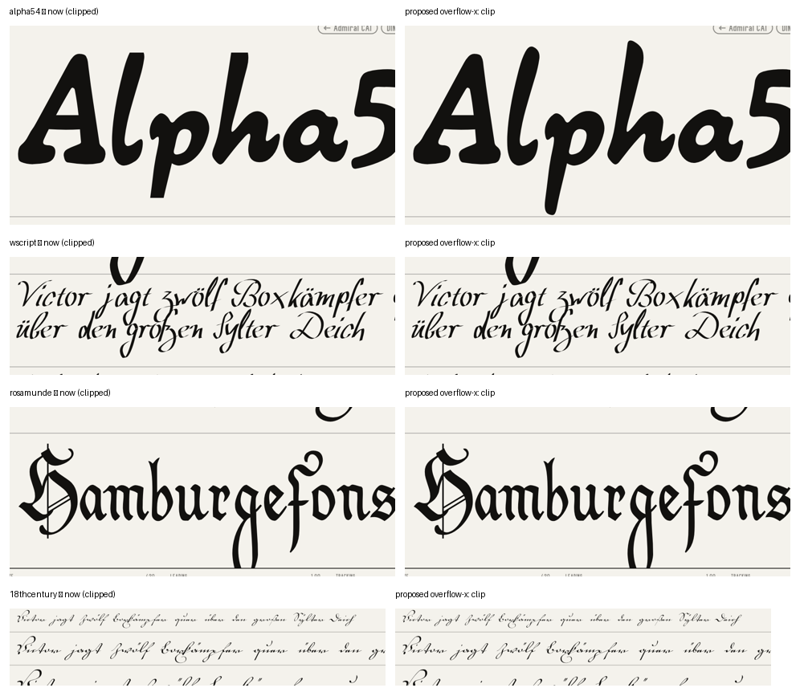

# Audit, 28 Oct 2026

**Scope:** CSS, JS, HTML, the Python build, docs against code, and specimen cropping, measured on every font.

**Method (Elephant–Goldfish):**
- Three zero-context reviewers read the code cold: CSS, JS, and build plus drift.
- I measured the cropping directly with Playwright on the hosted build (Chromium, 1440 and 390 wide).
- Findings marked **✓** I re-checked myself. The rest come with the reviewer's repro.

**Nothing in this audit has been applied.** The site is signed off as pixel-perfect. Each item says **render-identical** or **changes rendering**.

## 1. Cropped specimens: the main finding ✓

**What:** glyph ink is cut off flat on font pages. Ascenders, descenders, swashes and accents are sliced at the line box.



**Measured** (ink outside the clip box, every font page):

| | Desktop 1440 | Phone 390 |
|---|---|---|
| Lines cut by > 2 px | 318 (217 specimen lines, 101 waterfall lines) | 154 |
| Fonts affected (> 2 px) | **148 of 337** | 72 |
| Lines cut by > 5 px | 202 lines, 114 fonts | — |
| Sides cut (> 2 px) | bottom 175 · top 126 · left 67 · right 13 | — |

The worst cases cut 50–100 px at specimen size: Rosamunde, Wolgast Script, Elbic Caslon, Lohengrin, Unbenannt 1, Nathan, H1N1, Tyskland, Powerweld.

**Cause, upstream:**
- `app.css:265` `.blk.fit .ed { overflow: hidden }`, together with `line-height: 1.0–1.05` for the fit roles (`LEAD` in `app.js`).
- The fit width is already computed with canvas `measureText` (`fitBlocks`, `app.js:358`), so the clip does no layout work. Its only job is to stop text typed by the user from running across the page. As a side effect it cuts every ink part outside the em box.
- The waterfall repeats the pattern: `.waterfall` and `.wf .tx { overflow: hidden }` (`app.css:370, 373`).

**Proposed fix (changes rendering: the cut ink reappears; nothing else moves):**

```css
.blk.fit .ed { white-space: nowrap; overflow-x: clip; overflow-wrap: normal; }   /* was overflow: hidden */
.waterfall   { overflow-x: clip; }
.wf .tx      { overflow-x: clip; font-family: var(--ff); }
```

- `overflow-x: clip` keeps the other axis visible. Support: Safari 16+, Chrome 90+.
- The 3% slack in the fit covers most left and right overhang. A few swash fonts (67 lines) also lose their left side: `overflow-clip-margin` would fix those in Chrome, but Safari ignores it.

**Second step, needs your call:**
- With the clip removed, 24 specimen lines in 19 fonts would push ink across the rule above or below their block: Alpha54, Coentgen, Constantia, Elbic Caslon, Euroscript, Fridolin, H1N1, Lohengrin, Nathan, Pommern Gotisch, Powerweld, Präsent 60, Rosamunde, Transit, Tyskland, Unbenannt 1, Variété, Wolgast, Wolgast Script.
- Options:
  - (a) accept the ink crossing the rule, like a swash crossing a column rule in print
  - (b) pad those blocks by each font's measured ink extent (`head.yMax/yMin`, already in `build-report.json`)

**Index list ✓:** clean. No name is cut left or right. Two rows (Powerweld 9 px, Wolgast Script 4 px) touch the next row's rule with descenders.

## 2. Three fonts never show ✓

- **Fonts:** Berlin Email Serif (`berlinemail`), CBE Normal (`cbe`), Waschküche (`waschkueche`).
- **Cause:** Chrome's font sanitizer (OTS) rejects them with "name: Failed to serialize table", so the page falls back to "This font file can't be shown in a browser". The malformed records are the old Mac-platform (1,0,0) name records.
- **Test:** I dropped those records in a copy. All three then load in Chromium.
- **Proposal:** `build.py` writes a display copy without Mac name records when a file fails this check. The originals stay untouched under Files. *Changes rendering* (the three fonts get specimens).
- **Side effect today:** on those pages the size, leading and tracking sliders stay on screen but do nothing, and Characters is empty with no message.

## 3. Bugs (render-identical unless noted)

| # | Where | What | Fix |
|---|---|---|---|
| B1 ✓ | app.js:502 | **XSS through the URL hash** on `font.html`: the slug goes into `innerHTML` | build the message with `textContent` |
| B2 | app.js:499-509 | **Hash race:** a slow pack can paint the previous font under the new hash (repro: delayed `p15.json`) | token check after `await` |
| B3 | app.js:500 | a malformed `%` in the hash throws `URIError` | try/catch around `decodeURIComponent` |
| B4 | app.js:504 | a failed pack fetch is cached forever | delete `cache[pk]` on failure |
| B5 ✓ | app.js:403, 412 | **every hash navigation adds a resize listener**; old observers keep detached pages alive (20 navigations → 95 rect reads per resize) | one module-level handler or an `AbortController` per `initFont` |
| B6 | app.js:465, 483 | pill ink-centring is computed once. **After an iPad rotation across 800 px the pills keep the old padding**, so the bar differs from a fresh load | re-run `inkAll()` on the media-query change. *Changes rendering after rotation only, to match a fresh load* |
| B7 | app.js:176 | a bad saved index state in `sessionStorage` (`{"sel":null}`) stops the whole script | validate the shape; default `cv/ic/tg` to `[]` |
| B8 | app.js:373 | a style change has no `.catch`; a failed face leaves `cur` wrong | keep the old face until the load succeeds |
| B9 ✓ | build.py main | in a copy without the raw fonts (the cloud), `build.py` crashes copying absent faces; only `hosted.py` runs | skip missing files |
| B10 | build.py:783 | the photo `onerror` puts an HTML-escaped URL inside a JS string | `json.dumps` the URL |
| B11 ✓ | app.css:67 vs 82 | **C and M never look "on"**: `.top .mode` comes later at the same specificity and resets the outline. On iPad there is no feedback at all | is that intended? If not: `.top .mode.on { box-shadow: inset 0 0 0 var(--line) var(--navfg) }`. *Changes rendering* |

## 4. Should-fix

**Performance**
- Typing in the index search costs ~0.5 s per keystroke:
  - all 337 rows are rebuilt
  - the code reads layout right after writing it
  - each font's search text is rebuilt 7 × 337 times
- The body-wide MutationObserver re-centres all ~107 pills on every grid change and every keystroke in the write box.
- **Fixes:** skip identical rebuilds, precompute the haystack, ignore `#grid` mutations. *Render-identical.*

**Dead CSS** (~25 rules: `.bar*`, `.card*`, `.frow`, `.feats`, `.top .cur/.sep/.push`, `.ca.u`, `[data-theme]` branches never set, padding overridden by `.homegrid .homelist`)
- **Fix:** delete. *Render-identical.*

**The "smallest text" block** at the end of `app.css` silently overrides component rules by source order:
- `.vl` opacity .45 is never seen
- the year colour per lane is never seen
- the glyph-code hover reveal is never seen
- **Fix:** delete the dead declarations (*render-identical*), or restore them if they were the intent (*changes rendering*).

**Safari units without fallback**
- `1cap` (Safari 17.2+) in the circled arrows: without it the ring falls back to its default size.
- `1lh` (16.4+) in the C/M circles: replace with `calc(var(--ui) * var(--lh) + 3px)`, which gives the same 30 px.
- `color-mix` (16.2+) underpins `--ink-2/3` and `--rule`.
- **Action:** check the iPad's iPadOS version.

**Sticky hover on iPad:** ~16 hover rules sit outside `@media (hover:hover)`, against the rule in RULES.md.
- *Changes rendering on touch only.*

**Accessibility**
- `aria-live` sits on the whole 337-row list; move it to the count.
- No Escape on the colour panel.
- No `aria-pressed` on M, I or the swatches.
- No `aria-sort` on the catalogue headings.
- C's accessible name is "C".
- *Render-identical.*

**Robustness** (`build.py`)
- Silent `except: pass` around zip, font and icon-pool loading. If a pool font fails in one copy only, the cloud and Mac chip marks can differ.
- `deco()` regexes the whole document.
- Inline JSON is not guarded against `</script>`.
- URL schemes are not checked.
- *All render-identical.*

**Duplication between `build.py` and `hosted.py`**
- The page list is written out in both.
- `hosted.py` guesses UI font weights from file names.
- Photo resizing is repeated with different settings.
- `B.SITE` is swapped without `finally`.
- **Fix:** one `render_all(out, cat)`. *Render-identical.*

## 5. Nits

- **Dead JS:** `fit()`, the `"plain"` branch in `setPal`, `WA_initFont`.
- **Dead Python:** `NAVPAL`, `NO_GREEN`, `UI_DIN`, the `dup` flag.
- **Naming:** globals mix `_x` and `WA_x`.
- **Duplication:** the footer text is a literal twice.
- **Small sizes break the `--info` floor:** glyph codes use 11 px mono and the decade labels 10 px on phone. Is that intended?
- **Magic numbers:** the 40 px list head appears four times; three different input-pill paddings.
- **HTML:** valid across all 9 pages and 337 font bodies (html5lib):
  - 0 parse errors
  - no duplicate ids
  - no dangling `aria-controls`
  - two empty `<a href="#">` on the first and last font's prev/next

## 6. Docs drift (fixed in this pass)

- **HANDOFF:** it described the old bar (Index, Catalogue in the bar, legend on About) and pre-change screenshots. It is now rewritten, and the 13 screenshots are retaken.
- **`archive.md` (v1):** the UI font, the 12 pairs, `templates.py`/`icons.py`/`serve.command`, the slider range and the waterfall sizes no longer exist as written. It is now marked superseded.
- **Undocumented until now:**
  - `merge.py`
  - that `build.py` rewrites `build-report.json`
  - the absent-font fallback
  - DIN surviving as the source of two chip marks
  - the 4 chips that fall back to live text
  - all of these are now in HANDOFF, ICONS and tools/README

## Suggested order

1. **Render-identical safety and robustness:** B1–B5, B7–B10, the dead CSS/JS, accessibility. These need no visual sign-off; verify by hashing the screenshots before and after.
2. **Cropping fix** (§1). Then decide (a) or (b) for the 19 fonts.
3. **The three OTS fonts** (§2).
4. **Decide:** C/M "on" state (B11), the rotation re-centring (B6), the `.vl` opacity and lane colours, sticky hover.
